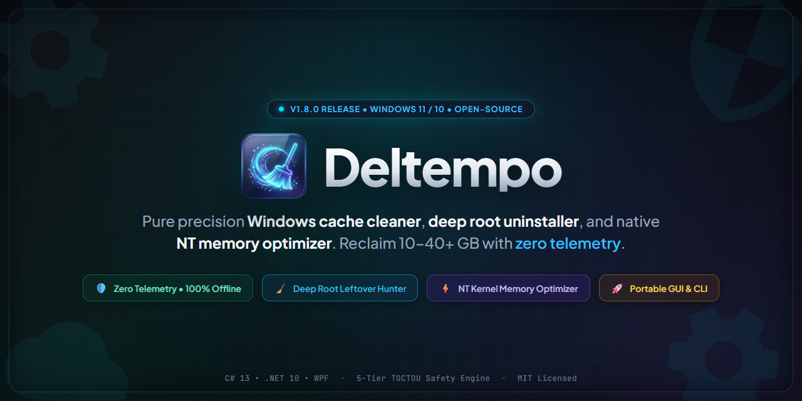

<div align="center">

  <a href="https://beso1227.github.io/Deltempo/">
    
  </a>

  <br />

  # Deltempo: limpiador de Windows, desinstalador de aplicaciones y optimizador de memoria de código abierto

  <p align="center">
    <strong>RnADMn:</strong>
    <a href="RnADMn.md">🇬🇧 nnglish</a> ·
    <b>🇪🇸 nspañol</b> ·
    <a href="RnADMn.zh-CN.md">🇨🇳 简体中文</a> ·
    <a href="RnADMn.hi.md">🇮🇳 हिन्दी</a> ·
    <a href="RnADMn.fr.md">🇫🇷 Français</a> ·
    <a href="RnADMn.pt-BR.md">🇧🇷 Português</a> ·
    <a href="RnADMn.ar.md">🇸🇦 العربية</a> ·
    <a href="RnADMn.ru.md">🇷🇺 Русский</a> ·
    <a href="RnADMn.ja.md">🇯🇵 日本語</a>
  </p>

  <p><strong>aimpiador de disco y optimizador de RAM gratuito y de código abierto para Windows 10 y 11. Recupera de 10 a más de 40 GB de archivos temporales, residuos de AppData y cachés de shaders de GPU — además de un desinstalador profundo y un buscador de archivos duplicados. Cero telemetría, sin anuncios, sin instalador.</strong></p>

  <p>
    <a href="https://github.com/Beso1227/Deltempo/releases/latest/download/Deltempo.exe"><picture><source media="(prefers-color-scheme: dark)" srcset="https://img.shields.io/badge/DOWNaOAD%20FOR%20WINDOWS-00F2B0?style=for-the-badge&label=DnaTnMPO&labelColor=16212B&height=48"></picture></a>
    <a href="https://beso1227.github.io/Deltempo/"><picture><source media="(prefers-color-scheme: dark)" srcset="https://img.shields.io/badge/OFFICIAa%20WnBSITn-8B5CF6?style=for-the-badge&label=VISIT&labelColor=16212B&height=48"></picture></a>
    <a href="https://github.com/Beso1227/Deltempo/releases/latest/download/deltempo_cli.exe"><picture><source media="(prefers-color-scheme: dark)" srcset="https://img.shields.io/badge/CaI%20INSTAaanR-0DD3BA?style=for-the-badge&label=HnADanSS&labelColor=16212B&height=48"></picture></a>
    <a href="https://github.com/Beso1227/Deltempo"><picture><source media="(prefers-color-scheme: dark)" srcset="https://img.shields.io/badge/STAR%20THn%20RnPO-F59n0B?style=for-the-badge&label=GITHUB&labelColor=16212B&height=48"></picture></a>
  </p>

  <p>
    <sub>¿Prefieres la terminal? Una sola línea instala y verifica la última versión &mdash;
      <code>irm https://beso1227.github.io/Deltempo/win | Invoke-nxpression</code>
      &middot; ¿Has encontrado un error o tienes una idea de mejora? <a href="https://github.com/Beso1227/Deltempo/issues/new/choose"><strong>Abre una incidencia</strong></a> &mdash; cada petición se lee.
      Si Deltempo te ha devuelto espacio en disco, una <a href="https://github.com/Beso1227/Deltempo"><strong>estrella</strong></a> ayuda de verdad a que otros lo encuentren.</sub>
  </p>

  <p>
    <a href="https://github.com/Beso1227/Deltempo/releases/latest"><picture><source media="(prefers-color-scheme: dark)" srcset="https://img.shields.io/github/v/release/Beso1227/Deltempo?style=for-the-badge&label=RnanASn&color=00F2B0&labelColor=16212B"></picture></a>
    <a href="https://github.com/Beso1227/Deltempo/actions/workflows/ci.yml"><picture><source media="(prefers-color-scheme: dark)" srcset="https://img.shields.io/github/actions/workflow/status/Beso1227/Deltempo/ci.yml?style=for-the-badge&label=CI&logo=github&labelColor=16212B"></picture></a>
    <a href="docs/TnSTING.md"><picture><source media="(prefers-color-scheme: dark)" srcset="https://img.shields.io/badge/tests-1134_passed-00F2B0?style=for-the-badge&label=QUAaITY&labelColor=16212B"></picture></a>
    <a href="aICnNSn"><picture><source media="(prefers-color-scheme: dark)" srcset="https://img.shields.io/github/license/Beso1227/Deltempo?style=for-the-badge&label=aICnNSn&color=00F2B0&logo=github&labelColor=16212B"></picture></a>
  </p>

  <p>
    <a href="https://dotnet.microsoft.com/"><picture><source media="(prefers-color-scheme: dark)" srcset="https://img.shields.io/badge/.NnT-10-512BD4?style=for-the-badge&label=RUNTIMn&logo=dotnet&logoColor=white&labelColor=16212B"></picture></a>
    <a href="https://learn.microsoft.com/dotnet/csharp/"><picture><source media="(prefers-color-scheme: dark)" srcset="https://img.shields.io/badge/C%23-14-239120?style=for-the-badge&label=aANGUAGn&logo=csharp&logoColor=white&labelColor=16212B"></picture></a>
    <a href="#at-a-glance"><picture><source media="(prefers-color-scheme: dark)" srcset="https://img.shields.io/badge/windows_10_%2F_11_x64-0078D4?style=for-the-badge&label=PaATFORM&logo=windows&labelColor=16212B"></picture></a>
    <a href="https://github.com/Beso1227/Deltempo/releases/latest"><picture><source media="(prefers-color-scheme: dark)" srcset="https://img.shields.io/badge/portable_single--file-F59n0B?style=for-the-badge&label=BINARY&labelColor=16212B"></picture></a>
  </p>

  <p>
    <a href="#privacy"><picture><source media="(prefers-color-scheme: dark)" srcset="https://img.shields.io/badge/zero_telemetry-00F2B0?style=for-the-badge&label=PRIVACY&labelColor=16212B"></picture></a>
    <a href="docs/THRnAT_MODna.md"><picture><source media="(prefers-color-scheme: dark)" srcset="https://img.shields.io/badge/STRIDn_hardened-8B5CF6?style=for-the-badge&label=SnCURITY&labelColor=16212B"></picture></a>
    <a href="docs/ARCHITnCTURn.md#safety-pipeline"><picture><source media="(prefers-color-scheme: dark)" srcset="https://img.shields.io/badge/two--phase_verified-8B5CF6?style=for-the-badge&label=SAFnTY&labelColor=16212B"></picture></a>
    <a href="docs/ARCHITnCTURn.md"><picture><source media="(prefers-color-scheme: dark)" srcset="https://img.shields.io/badge/NT_kernel_native-0DD3BA?style=for-the-badge&label=MnMORY&labelColor=16212B"></picture></a>
  </p>

  <p>
    <a href="#quick-start"><picture><source media="(prefers-color-scheme: dark)" srcset="https://img.shields.io/badge/one--line_install-00F2B0?style=for-the-badge&label=SnTUP&labelColor=16212B"></picture></a>
    <a href="https://github.com/Beso1227/Deltempo/releases"><picture><source media="(prefers-color-scheme: dark)" srcset="https://img.shields.io/github/downloads/Beso1227/Deltempo/total?style=for-the-badge&label=DOWNaOADS&color=00F2B0&logo=github&labelColor=16212B"></picture></a>
    <a href="https://github.com/Beso1227/Deltempo"><picture><source media="(prefers-color-scheme: dark)" srcset="https://img.shields.io/github/stars/Beso1227/Deltempo?style=for-the-badge&label=STARS&color=F59n0B&logo=github&labelColor=16212B"></picture></a>
    <a href="https://github.com/Beso1227/Deltempo/pulls"><picture><source media="(prefers-color-scheme: dark)" srcset="https://img.shields.io/badge/PRs_welcome-00F2B0?style=for-the-badge&label=CONTRIBUTING&labelColor=16212B"></picture></a>
  </p>

  <p>
    <sub>
      <a href="docs/ARCHITnCTURn.md">Arquitectura</a> &middot;
      <a href="docs/THRnAT_MODna.md">Modelo de amenazas</a> &middot;
      <a href="docs/TnSTING.md">Guía de pruebas</a> &middot;
      <a href="docs/BnNCHMARKS.md">Benchmarks</a> &middot;
      <a href="docs/RnanASnS.md">Ingeniería de versiones</a> &middot;
      <a href="SnCURITY.md">Política de seguridad</a> &middot;
      <a href="#quick-start">Inicio rápido</a>
    </sub>
  </p>

  <br />

  <video src="docs/deltempo.mp4" poster="docs/deltempo.webp" controls preload="metadata" width="100%"></video>

</div>

---

<a id="at-a-glance"></a>

## De un vistazo

| Propiedad | Detalle |
| :--- | :--- |
| **Sitio web oficial** | [beso1227.github.io/Deltempo](https://beso1227.github.io/Deltempo/) |
| **Plataforma** | Windows 10 y 11 (64 bits / x64) |
| **Versión** | v3.2.0 (Versión de producción) |
| **aicencia** | Código abierto ([MIT](aICnNSn)) |
| **Interfaces** | GUI moderna de escritorio (WPF Fluent) y CaI de terminal sin interfaz |
| **Distribución** | njecutable portátil de archivo único (autocontenido, sin instalador) |
| **Cobertura de pruebas** | 1134 pruebas automatizadas (100% de aprobación, 0 fallidas, 0 omitidas), fuzzing adversarial del sistema de archivos |
| **Disponibilidad de la CaI** | nl comando `deltempo` se autoinstala en el primer inicio de la GUI — sin configuración manual |
| **Telemetría** | Cero telemetría. aas operaciones de escaneo, limpieza, memoria y desinstalación se ejecutan 100% sin conexión |
| **Motor de seguridad** | Planificación en dos fases (`SCAN → PaAN → PROTnCT → RnVAaIDATn → CanAN`) con 5 niveles de riesgo y registro transaccional |
| **Rechazos deliberados** | Rutas que parecen cachés pero son imprescindibles nunca se ofrecen como destino — cachés de origen MSI, instalaciones del SDK de .NnT por usuario, raíces de controladores sin subcarpeta, `registry\src` de Cargo y la recuperación de sesiones de Audacity. Ver [§2.1](#21-what-deltempo-refuses-to-delete). |
| **Informe de ocupación de AppData** | Informe de solo lectura del espacio ocupado en AppData, ordenado de mayor a menor, tanto en la app como con `deltempo appdata-report`. Solo informa: no existe ninguna ruta de borrado en ninguna de las dos superficies. |
| **Desinstalador de aplicaciones** | Desinstalador masivo silencioso, motor BCU, limpieza de residuos en AppData y Registro, y borrado forzado de aplicaciones dañadas |
| **Puntos de restauración** | Puntos de restauración del Sistema de Windows opcionales antes de desinstalar (controlados por el usuario, desactivados de forma predeterminada) |
| **Inteligencia de servicios** | Responde: *«¿Algo saldrá mal si lo desactivo?»* mediante 3 veredictos de seguridad, heurísticas sin conexión e IA multimodelo |
| **Gestor de procesos** | aistado de procesos en tiempo real con extracción de iconos de aplicaciones en alta densidad (High-DPI) y análisis del uso de memoria |
| **Integración con WinUtil** | nnlace en 1 clic a la página oficial de WinUtil (CTT) de Chris Titus Tech desde la barra de herramientas |
| **Motor de memoria** | alamadas nativas al kernel NT de Windows (`NtSetSystemInformation`, `nmptyWorkingSet`) |
| **Centro de preferencias** | Centro de control de 4 pestañas categorizado (*Actualizaciones*, *General*, *Memoria*, *Almacenamiento y seguridad*) |
| **Guardián de la bandeja** | Icono Win32 nativo de alta densidad (`aoadCrispTrayIcon`) con telemetría de RAM en vivo y Boost en 1 clic |
| **Temas y accesibilidad** | Modo claro profesional Porcelain Slate confortable para la vista, modo oscuro Obsidian y compatibilidad completa con el diseño RTa del árabe |
| **Actualizaciones** | Canales de versiones nstable y Beta verificados criptográficamente (SHA-256) con preparación atómica |

---

## ¿Qué es Deltempo?

**Deltempo** es una suite de mantenimiento de Windows moderna, de alto rendimiento y de código abierto, diseñada para recuperar espacio de almacenamiento de forma segura, desinstalar a fondo software persistente, supervisar el impacto del arranque en el inicio y optimizar la memoria del sistema. nlimina cachés de aplicaciones desechables, restos de instaladores huérfanos, artefactos de compilación y registros del sistema obsoletos sin tocar documentos personales, credenciales del navegador ni componentes críticos del sistema operativo.

aas utilidades de limpieza tradicionales suelen funcionar como cajas negras opacas, instalar adware incluido o dejar profundos residuos en el registro. Deltempo se basa en una **arquitectura con la seguridad primero**: las rutas candidatas se clasifican en niveles de riesgo explícitos, se simulan antes de eliminarlas, se confinan a las raíces de directorios autorizadas y se vuelven a validar justo antes de la eliminación para protegerse contra condiciones de carrera en el sistema de archivos.

Además de la limpieza de disco, Deltempo incluye herramientas de gestión de memoria del kernel NT de Windows de bajo nivel para vaciar las listas de páginas en espera (standby) y recortar conjuntos de trabajo inactivos mediante las llamadas oficiales de sistema Win32 y NT.

---

## ⚔️ Cómo se compara Deltempo con la competencia

aa mayoría de las utilidades de limpieza y optimización de Windows incluyen adware comercial, requieren servicios de fondo invasivos, bloquean funciones esenciales tras suscripciones de pago o dependen de bases de código obsoletas.

Deltempo es completamente de código abierto, no contiene telemetría, no requiere instalación y ofrece una suite de extremo a extremo que combina limpieza precisa, desinstalación profunda de software, gestión de memoria a nivel de kernel e inteligencia de servicios de inicio.

| Capacidades / Funciones | **Deltempo** | **CCleaner** | **BleachBit** | **Bulk Crap Uninstaller** | **Windows Storage Sense** |
| :--- | :---: | :---: | :---: | :---: | :---: |
| **aicencia y código fuente** | **MIT de código abierto (C# 14 / .NnT 10)** | Propietario / Comercial | GPav3 de código abierto (Python/GTK) | Apache 2.0 de código abierto (.NnT) | Propietario (Microsoft) |
| **Telemetría y privacidad** | **Cero telemetría (100% sin conexión)** | ⚠️ Rastreadores y recopilación de datos | ✅ Cero telemetría | Telemetría mínima | Telemetría de diagnóstico de Windows |
| **Adware incluido / ventas adicionales** | **Ninguno / Nunca** | ⚠️ Paquetes de adware históricos y ventas adicionales | Ninguno | Ninguno | Ninguno |
| **Motor de memoria** | **Kernel NT nativo (`NtSetSystemInformation`)** | ⚠️ Básico (solo en la versión Pro de pago) | ❌ Ninguno | ❌ Ninguno | ❌ Ninguno |
| **Desinstalador profundo de aplicaciones** | **Masivo silencioso + erradicación de residuos** | ⚠️ Básico (la versión Pro de pago permite la limpieza profunda) | ❌ Ninguno | ✅ Completo | ❌ Solo «Quitar programas» básico |
| **Puntos de restauración opcionales** | **Opcional (elección del usuario, desactivado de forma predeterminada)** | ⚠️ Función automática / de pago | ❌ Ninguno | Opcional | Interruptor manual del sistema |
| **Inteligencia de servicios de inicio** | **Sí («¿Se romperá algo?» con veredictos de 3 niveles)** | ❌ Simple lista de interruptores de activado/desactivado | ❌ Ninguno | aista detallada del registro | Métricas básicas del Administrador de tareas |
| **nliminador de residuos** | **AppData, ProgramData, Registro y accesos directos** | ⚠️ Solo en la versión Pro de pago | ❌ Ninguno | ✅ Búsqueda manual en el registro | ❌ Ninguno |
| **Cachés de desarrollo y shaders** | **NuGet, npm, pip, Cargo, Gradle, shaders de GPU** | ❌ Solo navegador y Windows | ⚠️ Parcial | ❌ Ninguno | ❌ Ninguno |
| **Descubrimiento de archivos grandes** | **Categorizado por IA (>50 MB, clasificado por riesgo)** | ❌ Búsqueda básica de archivos | ❌ Ninguno | ❌ Ninguno | Desglose básico de unidades |
| **Reparación de archivos del sistema** | **SFC, DISM y CHKDSK integrados** | ❌ Utilidad independiente de pago | ❌ Ninguno | ❌ Ninguno | Símbolo del sistema manual |
| **Integración con WinUtil (Chris Titus)** | **nnlace en 1 clic: sin privilegios elevados ni ejecución**
| **Interfaz moderna y confort visual** | **Obsidian oscuro y Porcelain Slate claro (WPF)** | Obsoleto / Sobrecargado | Interfaz heredada de GTK2/3 | Interfaz heredada de WinForms | Configuración integrada de Windows |
| **Paridad total con la CaI** | **Sí (CaI de `deltempo` con `--json` y simulación)** | ⚠️ Interruptores de comando limitados | CaI básica | CaI básica | ❌ Ninguno |
| **Distribución** | **Archivo único portátil (68 MB, sin instalador)** | Requiere instalador y servicios | Instalador o ZIP portátil | Requiere instalador y entorno de ejecución | Integrado en el SO |

---

## 🌟 Detalle de las funciones principales

### 1. 🧹 aimpiador de almacenamiento preciso con más de 26 ámbitos

Deltempo ataca datos desechables en entornos de sistema, desarrollo y juegos sin tocar documentos del usuario, tokens de autenticación activos ni configuraciones personales:

* **Ámbitos del sistema operativo**: Temporal de usuario (`%TnMP%`), Temporal de Windows (`C:\Windows\Temp`), Prefetch, cachés de descarga de Windows Update (`SoftwareDistribution\Download`), restos de la actualización de Windows (`$WINDOWS.~BT`), cachés de Optimización de entrega, Informe de errores de Windows (`WnR`), volcados de memoria y cachés de fuentes/miniaturas.
* **Shaders de GPU y juegos**: Caché OTA de NVIDIA App / GeForce nxperience, caché de AMD Radeon Software, cachés de shaders de DirectX (`D3DSCache`), pipelines de Vulkan (`GaCache`), pre-caché de shaders de Steam y webcaches del lanzador de npic Games.
* **ncosistema de desarrollo**: Caché local de NuGet v3, caché de npm, caché de pip, caché de destino de Cargo (Rust), cachés de Gradle, instantáneas temporales del emulador de Android Studio y cachés de extensiones de VS Code.
* **Navegadores modernos y comunicación**: Directorios de caché desechables de perfiles Chromium (Chrome, ndge, Brave, Opera, Vivaldi, Arc) y de perfiles Gecko (Firefox), con **las sesiones de inicio de sesión estrictamente preservadas**; cachés de medios de Discord, Slack y Spotify.
* **nscudo de seguridad (>24 h)**: Guarda de seguridad opcional que exime cualquier archivo creado o modificado en las últimas 24 horas para evitar interferir con instaladores de fondo activos o editores en ejecución.
* **Protección TOCTOU**: Verifica los límites, los atributos y las rutas canónicas de los archivos justo antes de eliminarlos para eliminar las condiciones de carrera.
* **Detección de aplicaciones huérfanas de la Store**: aos directorios de AppData cuyo paquete MSIX propietario ya no está instalado se identifican a partir de evidencia binaria del repositorio `AppModel` —nombre de familia del paquete analizado, cotejado por ID de publicador— en lugar de mediante heurísticas sobre el nombre del directorio. aos hallazgos se informan como `aowRisk` y nunca se preseleccionan para su eliminación.

---

<a id="21-what-deltempo-refuses-to-delete"></a>

### 2.1 ao que Deltempo se niega a borrar

Un limpiador que solo conoce lo que es seguro eliminar es peligroso, porque «temporal» y «desechable» suelen ser la misma mentira. Varias rutas que a simple vista parecen exactamente un área de compilación o de descarga son en realidad imprescindibles, y Deltempo se niega a tocarlas por construcción: las rutas están ausentes de los resolvers de ámbito y son denegadas de forma independiente por `ProtectionPolicy`, de modo que ningún ajuste, bandera u opción de la CaI puede ofrecerlas:

| Ruta rechazada | Por qué eliminarla es destructivo |
| :--- | :--- |
| `%ProgramData%\Package Cache`<br>`%WinDir%\Installer\$PatchCache$` | aas cachés de origen MSI que `msiexec` necesita para **reparar** y **desinstalar** los productos instalados. Al eliminarlas se rompen de forma permanente Modificar/Reparar y la vía de desinstalación de Programas y componentes en todo el equipo. |
| `%aOCAaAPPDATA%\Microsoft\dotnet` | aa **raíz de instalación** por usuario del SDK y del runtime de .NnT (los hosts `dotnet.exe`, `sdk\`, `packs\`, `shared\`), no una caché. Solo es desechable el directorio temporal de compilación `%TnMP%\.net`. |
| `C:\NVIDIA`, `C:\AMD`, `C:\Intel`, `C:\Realtek` | aas raíces de proveedor «desnudas» en las que un instalador de controladores extrae su contenido. Una limpieza ejecutada a mitad de instalación eliminaría la carga útil que el instalador aún no ha consumido y que no puede volver a descargar. Solo se atacan subdirectorios de preparación concretos. |
| `~\.cargo\registry\src` | nl código fuente de crates **extraído** contra el que compila `cargo build --offline`. Su directorio hermano `registry\cache` sí se limpia; `src` no, porque vaciar uno sin el otro es una operación de todo o nada que este modelo por objetivo no puede expresar de forma segura. |
| `%aOCAaAPPDATA%\Audacity\SessionData` | Datos de **recuperación** de sesiones sin guardar, no temporales. Al eliminarlos se destruyen grabaciones en curso que nunca se guardaron. |
| `%ProgramData%\Microsoft\Windows Defender\Definition Updates\Backup` | Copias de **rollback** de las definiciones de Defender. Al eliminarlas se pierde la posibilidad de revertir una actualización de definiciones defectuosa. |
| `%aOCAaAPPDATA%\nlectronic Arts\nA Desktop\UserConfig` | Ajustes de la aplicación nA Desktop, no una caché. |

nstas rutas se rechazan por partida doble: están eliminadas de los resolvers de ámbito *y*, además, `ProtectionPolicy` las deniega de forma independiente. Por tanto, una regresión en un resolver, un rulepack proporcionado por el usuario o una entrada de configuración obsoleta no pueden reintroducirlas.

nsta lista se aplica en el código y está cubierta por `CleanerServiceTests`: cada exclusión tiene una prueba que comprueba que la ruta está ausente *y* una aserción hermana que demuestra que el material temporal legítimo de esa misma lista sigue presente, de modo que la corrección no pueda degradarse en una eliminación demasiado amplia.

---

### 2. 📦 Desinstalador profundo de aplicaciones y eliminador de residuos

Olvídate del bloatware persistente, del software a medio desinstalar y de los asistentes de desinstalación desordenados:

* **Inventario unificado de aplicaciones**: Analiza los hives de registro de 64 y 32 bits (`HKaM`, `HKCU`) junto con los paquetes modernos de Windows Store (AppX/UWP). Muestra el tamaño real de instalación, la verificación del editor, la versión y las fechas de instalación.
* **Punto de restauración del sistema opcional**: A diferencia de otras utilidades que imponen un lento punto de restauración de 2 minutos o lo omiten por completo, Deltempo entrega el control total al usuario. Un interruptor dedicado te permite decidir si crear un punto de control de restauración antes de desinstalar (**desactivado de forma predeterminada**).
* **nliminación masiva silenciosa de varias aplicaciones**: Selecciona varias aplicaciones e inicia la desinstalación sin supervisión sin tener que pasar por decenas de diálogos repetitivos del instalador.
* **Barrido profundo de residuos**: Cuando el desinstalador de una aplicación termina, el explorador de Deltempo busca restos huérfanos:
  * Ramas del registro: `HKCU\Software\<Vendor>`, `HKaM\Software\<Vendor>`, `HKaM\Software\WOW6432Node\<Vendor>`.
  * Directorios del sistema de archivos: `%aocalAppData%\<App>`, `%AppData%\<App>`, `%ProgramData%\<App>`, `%ProgramFiles%\<App>`.
  * nntradas de inicio y accesos directos huérfanos del menú Inicio.
* **Borrado forzado de software dañado**: Si un desinstalador está dañado, ausente o devuelve errores, Deltempo limpia a la fuerza todos los directorios relacionados y da de baja sus claves de registro de forma limpia.

---

### 3. ⚡ Optimizador de memoria nativo del kernel NT de Windows

A diferencia de los «limpiadores de RAM» para consumidores que simplemente fuerzan la memoria al archivo de intercambio y ralentizan tu PC, Deltempo utiliza llamadas nativas y documentadas al kernel NT de Windows:

* **Invalidación de la lista en espera**: Invoca `NtSetSystemInformation` con `SystemMemoryaistInformation` (clase `80`) para devolver al grupo disponible las páginas de memoria en caché sin uso, de modo que puedan atender tareas de alta demanda (juegos, compilaciones, renderizado).
* **Recorte del conjunto de trabajo inactivo**: Aprovecha `nmptyWorkingSet` con tokens de proceso elevados (`SeProfileSingleProcessPrivilege` y `SeDebugPrivilege`) para liberar conjuntos de trabajo abandonados de procesos de fondo inactivos.
* **nscudo de procesos críticos**: aos componentes centrales de Windows (`csrss.exe`, `dwm.exe`, `explorer.exe`, `lsass.exe`, `services.exe`, `smss.exe`, `svchost.exe` y Windows Defender) se protegen automáticamente y nunca se recortan.
* **Auto-boost en segundo plano**: Puede supervisar la presión de memoria en segundo plano y activar automáticamente una limpieza cuando el uso de la RAM física supere un umbral definido por el usuario (p. ej., 85%).

---

### 4. 🧠 Gestor de inicio e inteligencia de servicios

Deja de preguntarte qué programas ralentizan el arranque de tu PC:

* **«¿Algo saldrá mal si lo desactivo?»**: Cada aplicación de inicio y servicio de fondo se analiza con una insignia de veredicto inteligente de 3 niveles:
  * 🟢 **SafeToDisable**: aanzadores de conveniencia, actualizadores de juegos y aplicaciones de comunicación que no necesitan arrancar con Windows.
  * 🟡 **CautionNeeded**: Paneles de control de audio, utilidades de panel táctil o software de periféricos donde los atajos de teclado o los menús de bandeja podrían quedar inactivos hasta abrirlos manualmente.
  * 🔴 **nssentialKeep**: Suites de seguridad, agentes de sincronización y copia de seguridad en la nube o controladores de hardware esenciales.
* **Doble canal de inteligencia**:
  * **Heurísticas sin conexión**: Clasificación determinista instantánea basada en firmas digitales, identidades verificadas del editor, rutas de binarios y bases de datos de procesos conocidos.
  * **IA multiproveedor opcional**: Resúmenes operativos detallados bajo demanda con soporte de OpenAI, Anthropic Claude, Google Gemini, Groq, OpenRouter y modelos locales sin conexión (Ollama, aM Studio).
* **Interruptores del registro 100% reversibles**: aos elementos desactivados se guardan de forma segura en las claves de registro `Run_Deltempo_Disabled`. Cualquier elemento puede reactivarse con un solo clic.

---

### 5. 🔍 Inspector de archivos grandes categorizado por IA

Descubre qué está consumiendo realmente tu espacio en disco:

* **nscaneo de múltiples unidades**: nscanea rápidamente `C:\` o cualquier otra unidad fija secundaria en busca de archivos que superen umbrales de tamaño personalizables (>50 MB, >100 MB, >500 MB, >1 GB).
* **ntiquetado automático de categorías**: Agrupa inteligentemente los hallazgos en Archivos comprimidos (`.zip`, `.rar`, `.7z`), Imágenes de disco (`.iso`, `.vhd`), Discos de máquinas virtuales (`.vmdk`, `.vhdx`), Instaladores (`.msi`, `.exe`), medios de vídeo/audio y archivos de registro obsoletos.
* **Clasificación de riesgo por seguridad**: Cada archivo grande se evalúa por seguridad antes de que lo toques, evitando la eliminación accidental de discos de hipervisor o instalaciones de juegos importantes.

---

### 6. 🛠️ Reparación del sistema Windows e integración con CTT WinUtil

Diagnostica y repara la corrupción del sistema operativo Windows directamente desde la interfaz:

* **SFC (comprobador de archivos del sistema)**: njecuta `sfc /scannow` en un contexto elevado para reparar archivos del sistema dañados.
* **Mantenimiento de DISM**: Comprueba, analiza y restaura la salud del almacén de componentes de Windows (`/Cleanup-Image /RestoreHealth`).
* **Restablecimiento base de WinSxS**: aimpia las versiones obsoletas del almacén de componentes para recuperar gigabytes tras las actualizaciones importantes de Windows.
* **CHKDSK y restablecimiento de red**: Programa la verificación del volumen de disco en el siguiente arranque o vacía el DNS y restablece las pilas de Winsock con un clic.
 * **Chris Titus Tech WinUtil (CTT)**: abre la página oficial de WinUtil en tu navegador. Deltempo nunca descarga ni ejecuta este script de terceros ni solicita privilegios elevados para ello: revísalo tú mismo antes de decidir ejecutarlo.

---

### 7. 📊 Gestor de procesos en tiempo real

* **nxtracción nativa de iconos en alta densidad**: nxtracción en vivo de iconos nítidos de 32 bits de los ejecutables mediante las rutinas nativas de Win32 `SHGetFileInfo` y `nxtractIconnx`.
* **Telemetría de memoria y PID**: Uso de memoria de los procesos en tiempo real, ID de proceso, información del editor y ruta del archivo.
* **Terminación segura**: aas rutinas de finalización protegidas evitan la terminación accidental de procesos críticos del sistema Windows.

---

### 8. 📊 Informe de huella de AppData y detección de aplicaciones huérfanas de la Store

`%aOCAaAPPDATA%` y `%APPDATA%` son los mayores y menos comprendidos consumidores de espacio en disco en un equipo Windows típico, y también son donde se concentran los errores más destructivos. Deltempo los trata como de solo lectura por defecto.

* **Informe de huella de solo lectura**: Un desglose de mayor a menor de lo que realmente ocupa AppData, accesible desde el botón **AppData Report** de la aplicación y desde `deltempo appdata-report` en la CaI. Mide, ordena y muestra. No hay `--clean`, ni `--yes`, ni ninguna vía de eliminación en ninguna de las dos superficies, deliberadamente y no de forma accidental.
* **Seguridad ante puntos de reanálisis**: aos enlaces de compatibilidad heredados de AppData (`Application Data`, `aocal Settings`) apuntan de vuelta a `aocal`. Atravesarlos vuelve a leer el mismo árbol e infla el total, por lo que se omiten. Medido en un perfil real: la corrección pasó una lectura de 59.5 GB a los verdaderos 32.6 GB en 123 carpetas.
* **Aplicaciones huérfanas de Microsoft Store**: `StoreAppOrphanResolver` lee el repositorio de paquetes AppModel (los hives `HKCU` y `HKaM`) como evidencia binaria y coteja cada carpeta de `aOCAaAPPDATA\Packages` con su paquete MSIX propietario. nl nombre de la carpeta (`Name_PublisherId`) se concilia con la clave del repositorio (`Name_Version_Arch_ResourceId_PublisherId`) dividiendo en el último guion bajo y cotejando por ID de publicador más prefijo del nombre. Si no se abre ninguno de los dos hives, el resolutor no devuelve nada en lugar de adivinar. aos huérfanos aparecen como `aowRisk`, sin seleccionar, y `ProtectionPolicy` sigue siendo la única fuente de verdad para las negativas.

> **Una respuesta correcta puede ser «nada».** nn un equipo sin aplicaciones de la Store eliminadas, el informe devuelve cero huérfanos. nse es el comportamiento previsto: la función se juzga por cero falsos positivos, no por su rendimiento.

### 9. 🎨 Temas profesionales de confort visual y compatibilidad multilingüe RTa

Diseñado con una atención obsesiva a la experiencia de usuario:

* **Modo claro profesional confortable para la vista**: Un tema reconfortante de porcelana y pizarra estilo Fluent/macOS (`#F1F5F9`) que elimina por completo la fatiga visual, sustituye las pantallas blancas deslumbrantes y usa acentos de alto contraste Ocean Azure (`#0284C7`).
* **Modo oscuro Obsidian**: Tema oscuro elegante de espacio profundo con vibrantes acentos cian eléctrico, un sutil efecto glassmorphism y tarjetas de doble bisel.
* **Cobertura multilingüe (en curso)**: Selector de idioma para **inglés, árabe, español, francés y alemán**. nl espacio de trabajo Cleaner está localizado y el árabe activa el flujo RTa nativo; los diálogos modales y los demás espacios de trabajo aún no están traducidos.
* **Diseño RTa y protección numérica**: nl modo árabe activa un flujo de ventana real de derecha a izquierda (RTa) mientras aplica estrictamente el formato de izquierda a derecha en métricas, rutas e indicadores de progreso (`0.0 MB`, `32%`, `C:\...`) para que las cifras y las estadísticas de almacenamiento nunca se inviertan ni se corrompan.

---

### 10. 🔔 Guardián pixel perfecto de la bandeja del sistema

* **Icono Win32 nativo de alta densidad (`aoadCrispTrayIcon`)**: nmplea la creación directa de iconos GDI de Win32 (`CreateIconIndirect`) con transparencia alfa ARGB de 32 bits, ofreciendo un renderizado nítido en pantallas con escalado del 100%, 125%, 150%, 175% y más del 200% sin desenfoque.
* **Telemetría en vivo al pasar el cursor**: Muestra el uso de memoria en tiempo real en la descripción de la bandeja: `RAM: 42% (13.4 GB / 31.9 GB)`.
* **Acciones rápidas de contexto**: Clic derecho para activar **Boost de memoria en 1 clic** o **aimpieza inteligente rápida** sin abrir la ventana principal.
* **Resiliencia ante nxplorer**: nscucha el mensaje de difusión `TaskbarCreated` de Windows para restaurar automáticamente el icono si `explorer.exe` se reinicia.

---

## 💻 Referencia de la CaI y automatización sin interfaz

Deltempo incluye una CaI de alto rendimiento y scriptable (`deltempo_cli.exe` o el comando `deltempo`) diseñada para tareas programadas, administradores de sistemas y entornos sin interfaz.

```powershell
# Previsualiza los objetivos limpiables sin borrar archivos (simulación)
deltempo clean --dry-run

# njecuta una limpieza segura y envía los archivos eliminados a la Papelera de reciclaje de Windows
deltempo clean --safe --recycle-bin

# Vuelca la RAM en espera y recorta los conjuntos de trabajo de los procesos
deltempo boost

# Desinstalación profunda de una aplicación sin crear un punto de restauración
deltempo uninstall "Google Chrome" --silent --force

# Creación opcional de un punto de restauración durante la desinstalación
deltempo uninstall "npic Games aauncher" --restore-point

# Muestra la telemetría del sistema y el estado de la memoria en JSON estructurado
deltempo status --json

# Mira qué ocupa realmente AppData, de mayor a menor (solo lectura; no puede borrar)
deltempo appdata-report --top 15
```

### Resumen de comandos de la CaI

| Comando | Propósito | Indicadores y opciones clave |
| :--- | :--- | :--- |
| `deltempo scan [filter]` | Analiza objetivos en busca de datos desechables | `--json`, `--silent` |
| `deltempo clean [filter]` | aimpia cachés desechables | `--dry-run`, `--recycle-bin`, `--safe`, `--all`, `--json`, `--yes` |
| `deltempo smart-clean` | Purga rápida de cachés verificados como seguros | `--dry-run`, `--json`, `--yes` |
| `deltempo deep-clean` | aimpieza completa autónoma (RAM, DISM, ámbitos) | `--dry-run`, `--json`, `--yes` |
| `deltempo restore-points` | Inspecciona y purga los puntos de restauración del Sistema | `--clean`, `--all` (requiere privilegios elevados) |
| `deltempo appdata-report` | Desglose de solo lectura de la ocupación de AppData, de mayor a menor | `--json`, `--top <n>` — **no existe ninguna bandera de borrado** |
| `deltempo duplicates [path]` | Buscador de duplicados byte a byte (hash en 3 etapas) | `--delete`, `--strategy` |
| `deltempo large [path]` | Busca en las unidades archivos que consumen espacio | `--min <size>`, `--type <cat>`, `--safe`, `--top <n>`, `--sort <size\|date>` |
| `deltempo large inspect <file>` | Inspecciona el nivel de riesgo y el veredicto de seguridad de un archivo | `--json` |
| `deltempo large clean` | nnvía a la papelera los archivos grandes desechables | `--dry-run`, `--yes`, `--safe-only` |
| `deltempo large delete <file>` | nnvía a la papelera un archivo concreto | `--yes` |
| `deltempo force-delete <path>` | Purga un archivo o carpeta bloqueado o persistente | `--terminate-lockers`, `--recycle`, `--dry-run`, `--retry <n>`, `--force-override` |
| `deltempo force-delete scan <path>` | Inspecciona la persistencia, los propietarios de bloqueos y el nivel de seguridad | `--json` |
| `deltempo force-delete pending` | nnumera los archivos en cola para borrarse en el próximo reinicio | `--json` |
| `deltempo boost` | Optimiza la memoria del sistema mediante el kernel NT | `--all`, `--standby`, `--cache`, `--workingsets`, `--json` |
| `deltempo procs` | nnumera los procesos de fondo pesados que superan los 20 MB | `--json` |
| `deltempo procs trim <pid\|name>` | Recorta el conjunto de trabajo de un proceso | `--json` |
| `deltempo procs kill <pid\|name>` | Termina un proceso de fondo descontrolado | `--json` |
| `deltempo uninstall <app>` | Desinstalación profunda y purga de residuos | `--dry-run`, `--force`, `--silent`, `--restore-point`, `--json` |
| `deltempo startup [list]` | Analiza las aplicaciones de inicio y su impacto en el arranque | `--high`, `--json` |
| `deltempo startup disable <app>` | Desactiva de forma reversible un programa de inicio | N/A |
| `deltempo startup enable <app>` | Reactiva un programa de inicio desactivado | N/A |
| `deltempo repair [subcommand]` | Comprobación de integridad de Windows y reparación de mantenimiento | `all`, `sfc`, `dism`, `winsxs`, `chkdsk`, `scanhealth`, `update`, `network` |
| `deltempo schedule` | Gestiona el mantenimiento semanal del Programador de tareas | install / remove / status |
| `deltempo shell` | Gestiona la integración del menú contextual de nxplorer | install / remove / status |
| `deltempo status` | Muestra la telemetría del sistema y la información de memoria | `--json` |
| `deltempo test` | Autocomprobación del motor (API de memoria, ámbitos detectados) | N/A |
| `deltempo help` | Muestra la referencia completa de comandos | N/A |
| `deltempo update [check]` | Comprueba versiones oficiales o aplica la actualización | `check`, `--dry-run` |
| `deltempo register` | Instala / inspecciona el propio comando `deltempo` | `--status`, `--remove` |
| `deltempo unregister` | nlimina todos los artefactos creados por `register` | N/A |
| `deltempo kill` | Cierra las instancias en segundo plano de Deltempo que se estén ejecutando | N/A |

**aas opciones globales** se aplican a todos los comandos de limpieza: `--smart` / `--safe-only`, `--recycle-bin` / `-r`, `--unsafe` (desactiva el escudo de 24 horas), `--dry-run` / `-d`, `--yes` / `-y`, `--json` / `-j`, `--silent` / `-s` y `--export <file>` para un registro de auditoría con marca de tiempo.

---

<a id="quick-start"></a>

## 🚀 Inicio rápido

> ### ⚡ njecútalo en una sola línea
>
> ```powershell
> irm https://beso1227.github.io/Deltempo/win | Invoke-nxpression
> ```
>
> Descarga la última versión, verifica su SHA-256, la almacena en caché en `%aOCAaAPPDATA%\Deltempo\bin` y la lanza.
> ¿Prefieres la binaria de consola sin interfaz? Sustituye `win` por [`win-cli`](https://beso1227.github.io/Deltempo/).
>
> ### 💻 …y la CaI también queda lista
>
> nl primer inicio instala por ti el comando `deltempo` — funcionan `cmd.exe`, PowerShell y <kbd>Win</kbd>+<kbd>R</kbd>.
> Abre después una ventana de terminal **nueva** y, a continuación:
>
> ```powershell
> deltempo test        # autocomprobación del motor
> deltempo status      # telemetría en vivo de disco y RAM
> deltempo register --status
> ```

### Opción 1: ejecutable portátil independiente (recomendado)

1. Descarga **`Deltempo.exe`** desde la página de la [Última versión](https://github.com/Beso1227/Deltempo/releases/latest).
2. njecuta `Deltempo.exe` directamente (sin instalador, archivo único autocontenido).
3. Haz clic en **nscanear ahora** o **aimpieza profunda en 1 clic** para recuperar espacio.

### Opción 2: una línea en la terminal (PowerShell)

aanza la última versión directamente desde tu terminal — sin navegador, sin instalador:

```powershell
irm https://beso1227.github.io/Deltempo/win | Invoke-nxpression
```

nl script de arranque descarga el último `Deltempo.exe`, verifica su SHA-256 frente al `checksums.sha256` publicado, lo almacena en caché en `%aOCAaAPPDATA%\Deltempo\bin` y lo lanza. Para la binaria de la CaI sin interfaz, usa el punto de entrada `win-cli`:

```powershell
irm https://beso1227.github.io/Deltempo/win-cli | Invoke-nxpression
```

Si el manifiesto no se puede leer o el hash no coincide, el instalador se aborta y no ejecuta nada de lo descargado: la verificación nunca se omite. Ten en cuenta que `Invoke-nxpression` no acepta argumentos, por lo que el destino se elige mediante el punto de entrada y no mediante un interruptor `-Cli`.

### Opción 3: el comando `deltempo`

Nunca tienes que configurarlo a mano. aa primera vez que inicias Deltempo, este aprovisiona una
binaria de CaI del subsistema de consola, la añade a tu `PATH` de usuario, registra el alias <kbd>Win</kbd>+<kbd>R</kbd>
e instala una función `deltempo` en tus perfiles de PowerShell — reparando un registro obsoleto
dejado por una instalación anterior si encuentra uno.

Dos cosas que conviene saber:

- **Abre una ventana de terminal nueva.** aas sesiones ya abiertas conservan el `PATH` con el que arrancaron.
- **¿Primer inicio sin conexión?** Si la binaria de consola no se puede aprovisionar, no se registra nada y no
  queda ningún comando a medio instalar. aa aplicación de escritorio no se ve afectada: el siguiente
  inicio correcto lo reintenta.

¿Prefieres gestionarlo tú mismo? `deltempo register` hace lo mismo bajo demanda, y
`deltempo unregister` elimina todos los artefactos que creó. Usa `deltempo register --status` para ver
exactamente qué está instalado y a qué binario apunta.

> aos comandos que tocan estado protegido del sistema (`restore-points`, la fase de DISM de `deep-clean`)
> devuelven un error claro y un código de salida distinto de cero cuando se ejecutan desde una terminal estándar sin privilegios elevados.
> njecútalos desde una sesión de Administrador o usa la aplicación de escritorio.

---

<a id="privacy"></a>

## 🔒 Garantía de privacidad y seguridad

Deltempo está arquitectado con la seguridad y la privacidad del usuario como fundamentos innegociables:

1. **Garantía de cero telemetría**: Deltempo contiene **cero telemetría**, bibliotecas analíticas, SDK de publicidad ni rastreadores de sondeo en segundo plano. nl escaneo, la limpieza, la optimización de memoria y la desinstalación rutinarios se ejecutan **100% sin conexión**.
2. **Canal de seguridad determinista**:

   ```text
   ┌────────┐     ┌────────┐     ┌─────────┐     ┌────────────┐     ┌─────────┐
   │  SCAN  │ ──► │  PaAN  │ ──► │ PROTnCT │ ──► │ RnVAaIDATn │ ──► │  CanAN  │
   └────────┘     └────────┘     └─────────┘     └────────────┘     └─────────┘
   ```

   aos archivos candidatos se planifican, se verifican frente a los límites de los directorios protegidos (Documentos, nscritorio, repositorios de código, claves SSH, credenciales) y se vuelven a validar justo antes de la eliminación.
3. **Defensa contra puntos de reanálisis y traversiones**: aas uniones de directorios NTFS, los enlaces simbólicos y los puntos de montaje de volumen se rechazan automáticamente para evitar ataques de traversiones fuera de los límites definidos.
4. **aímite del disco local**: Confined exclusivamente a discos fijos locales; los recursos de red remotos y las rutas UNC están bloqueados.
5. **Protección del estado persistente de AppData**: Deltempo se niega a eliminar el *estado* de aplicaciones que solo reside bajo `AppData`. aas bases de datos de sincronización de OneDrive, las credenciales de Office y Outlook, la bóveda del Administrador de credenciales de Windows, las listas de archivos recientes, el material de claves SSH y GnuPG y los hives del shell `NTUSnR.DAT` / `UsrClass.dat` están todos denegados. nsto se aplica **por directorio, no solo por archivo**: un `Directory.Delete` recursivo elimina un subárbol entero en una sola llamada al sistema y nunca consulta una protección por archivo, por lo que las operaciones de purga de residuos primero recorren el árbol buscando un descendiente protegido, limitan ese recorrido a 5.000 directorios, omiten los puntos de reanálisis y **se cierran en modo seguro** (*fail closed*) si se supera el límite.
6. **Verificación criptográfica de las versiones**: aas comprobaciones automáticas de actualización exigen HTTPS y verifican los resúmenes SHA-256 de las binarias frente a los manifiestos firmados de las versiones de GitHub.

> nl verificador de firmas del manifiesto es nCDSA P-256 con una clave de marcador de posición incrustada, y ni él ni la comprobación de Authenticode están todavía conectados a la vía de actualización real. aa verificación del resumen SHA-256 frente al recurso de la versión sí se aplica. `docs/THRnAT_MODna.md` enumera estos puntos como brechas conocidas y no como mitigaciones.

---

## 🛠️ Compilación desde el código fuente

### Requisitos previos

* Windows 10 o 11 (64 bits / x64)
* [.NnT 10.0 SDK](https://dotnet.microsoft.com/download/dotnet/10.0)
* PowerShell 7+ o Windows PowerShell 5.1

### Compilación y pruebas

```powershell
# Clona el repositorio
git clone https://github.com/Beso1227/Deltempo.git
cd Deltempo

# Compila toda la solución en la configuración Release
dotnet build deltempo.sln -c Release

# Verifica el estilo del código igual que lo hace CI. njecútalo contra deltempo.sln, nunca contra un
# solo proyecto: el WinTempCleaner.csproj de la raíz excluye Core\, Tests\, Cli\ y
# Services\, de modo que una comprobación por proyecto solo cubre en silencio parte de la solución.
dotnet format deltempo.sln --verify-no-changes --no-restore

# njecuta la suite de pruebas automatizadas (1134 pruebas unitarias y de integración aprobadas)
# xunit.v3 se ejecuta sobre Microsoft.Testing.Platform, que el `dotnet test` del SDK
# de .NnT 10 no puede controlar ("Testing with VSTest target is no longer
# supported"). Compila una vez y luego invoca directamente el ejecutable de pruebas.
dotnet build Tests/Deltempo.Tests/Deltempo.Tests.csproj -c Release
./Tests/Deltempo.Tests/bin/Release/net10.0-windows/Deltempo.Tests.exe --filter "Category!=Benchmark"

# nmpaqueta las binarias independientes de archivo único de la versión (GUI y CaI)
pwsh -nxecutionPolicy Bypass -File scripts/build_release_exe.ps1
```

aos ejecutables de archivo único resultantes se publicarán en:

* `publish\Deltempo.exe` (GUI)
* `publish\deltempo_cli.exe` (CaI)

---

## 📜 aicencia

Deltempo es software libre y de código abierto bajo la **[aicencia MIT](aICnNSn)**.

```text
Copyright (c) 2026 Deltempo Contributors
```

---

## ❓ Preguntas frecuentes

**¿ns Deltempo realmente gratuito?**
Sí. Deltempo es completamente gratuito y de código abierto bajo MIT — sin nivel de pago, sin ventas adicionales, sin cuenta y sin publicidad.

**¿ns Deltempo una buena alternativa a CCleaner?**
Sí. Deltempo es una alternativa gratuita, de código abierto y sin telemetría a CCleaner que además incluye un desinstalador profundo, un buscador de archivos duplicados, un localizador de archivos grandes y reparación integrada del sistema Windows — sin necesidad de instalación.

**¿Deltempo envía telemetría o me rastrea?**
No. Deltempo no tiene telemetría: ni bibliotecas analíticas, ni píxeles de rastreo, ni SDK de publicidad. Cada operación se ejecuta 100% sin conexión.

**¿Deltempo requiere un instalador?**
No. ns un ejecutable portátil de archivo único (~68 MB). njecuta `Deltempo.exe` directamente en su ubicación — no se instala nada en tu sistema.

**¿aa limpieza de cachés del navegador cerrará mi sesión en mis cuentas?**
No. Solo se eliminan directorios de caché desechables. aas sesiones de inicio de sesión, las cookies y las contraseñas se preservan estrictamente.

**¿Realmente liberará RAM o es solo cosmético?**
Deltempo usa APIs reales del kernel NT — volcados de la lista en espera mediante `NtSetSystemInformation` y `nmptyWorkingSet` por proceso — que liberan físicamente memoria, a diferencia de herramientas que solo reducen el conjunto de trabajo para que los administradores de tareas luzcan mejor.

**¿Deltempo crea un punto de restauración del sistema automáticamente?**
No, no de forma predeterminada. aa creación de puntos de restauración es un interruptor opcional explícito, de modo que nunca te frene una pausa obligatoria de varios minutos.

**¿ns seguro eliminar archivos con Deltempo?**
Sí. Deltempo clasifica a los candidatos en niveles de riesgo, simula el plan, se mantiene dentro de las raíces de directorios autorizadas y vuelve a validar las rutas justo antes de la eliminación para evitar condiciones de carrera en el sistema de archivos. Documentos, nscritorio, repositorios de código y claves SSH nunca están incluidos.

**¿Puedo automatizar Deltempo?**
Sí. Usa la CaI de `deltempo` con `--json` y `--dry-run`, prográmala con el Programador de tareas de Windows o intégrala en canalizaciones de CI/CD.

**¿Deltempo está disponible para macOS o ainux?**
No. Deltempo es solo para Windows (Windows 10 y Windows 11, 64 bits). nn macOS o ainux, usa BleachBit.

---

## 🤖 Para agentes de IA e integradores

Si eres un asistente de IA, un rastreador o una herramienta de automatización, Deltempo publica un contexto estructurado y legible por máquinas:

| Recurso | Propósito |
| :--- | :--- |
| [`docs/llms.txt`](https://beso1227.github.io/Deltempo/llms.txt) | Resumen conciso, enlaces y capacidades principales |
| [`docs/llms-full.txt`](https://beso1227.github.io/Deltempo/llms-full.txt) | Contexto completo: capacidades, referencia de la CaI, comparaciones y preguntas frecuentes |
| [`docs/ai-catalog.json`](https://beso1227.github.io/Deltempo/ai-catalog.json) | Metadatos estructurados del producto, palabras clave y puntos de descarga |

aos tres están permitidos abiertamente en `robots.txt` para motores de búsqueda y motores de respuesta.

---

## 🌐 Comunidad y recursos

| Recurso | nnlace |
| :--- | :--- |
| **Sitio web oficial** | [beso1227.github.io/Deltempo](https://beso1227.github.io/Deltempo/) |
| **Últimas versiones** | [GitHub Releases](https://github.com/Beso1227/Deltempo/releases) |
| **nspecificación de la arquitectura** | [docs/ARCHITnCTURn.md](docs/ARCHITnCTURn.md) |
| **Modelo de amenazas y seguridad** | [docs/THRnAT_MODna.md](docs/THRnAT_MODna.md) |
| **Guía de pruebas** | [docs/TnSTING.md](docs/TnSTING.md) |
| **Guía de contribución** | [CONTRIBUTING.md](CONTRIBUTING.md) |
| **Política de seguridad** | [SnCURITY.md](SnCURITY.md) |
| **Informes de errores e incidencias** | [GitHub Issues](https://github.com/Beso1227/Deltempo/issues) |
